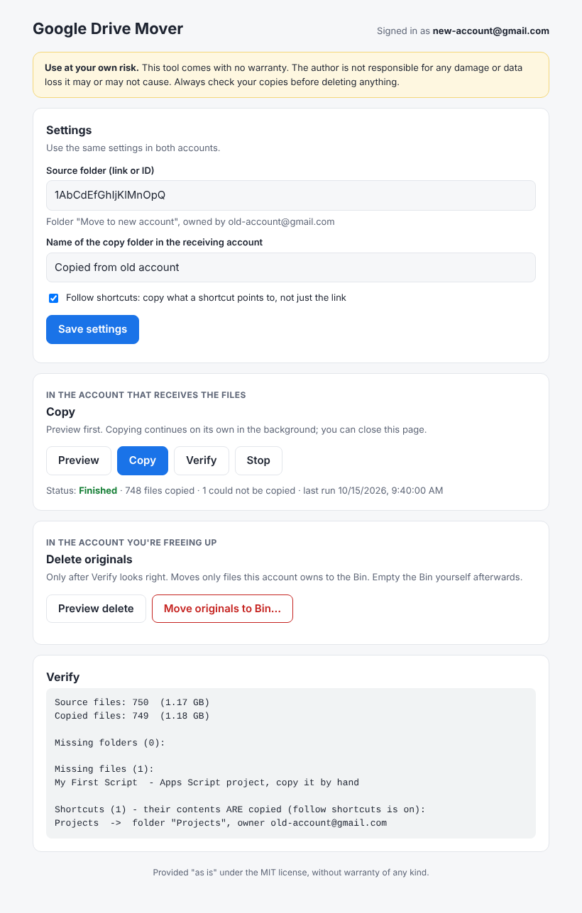

# Google Drive Mover

Move all your files from one Google account's Drive to another, to free up space in the first one. Free accounts share 15 GB across Gmail, Drive and Photos, so this is useful when one account is full and another has room.

It's a small [Google Apps Script](https://script.google.com) project with a simple web page. There's nothing to install, and it runs on Google's servers, so you can close the browser while it works.

> **Disclaimer:** This tool is provided "as is", without warranty of any kind. You use it at your own risk. The author is not responsible for any damage or data loss it may or may not cause. Always check your copies before deleting anything. See [Disclaimer](#disclaimer).



**What it does**

- **A simple web page** with your settings, a button for each step, live progress, and the reports.
- **Preview**: a dry run that shows what will be copied, which shortcuts will be followed, and which files a script can't copy. It changes nothing.
- **Copy**: copies a whole folder tree from the **source** account into the **destination** account. The copies are owned by the destination account, so they use its storage. It works around Apps Script's 6-minute limit by continuing on its own every minute, emails you when it's finished, and skips files that were already copied, so it's safe to run again.
- **Follows shortcuts**: it copies what a shortcut points to, not just the link.
- **Verify**: reports missing files and folders.
- **Delete originals**: runs in the source account. It moves only the files that account **owns** to the Bin, and tells you if it still owns files anywhere else. It asks you to type DELETE first, and has its own dry run.

## Why not just transfer ownership?

Google Drive lets you transfer ownership between personal accounts, but in the web interface you have to do it **one file at a time**. Transferring a folder doesn't transfer the files inside it (see [Pitfalls](#pitfalls)). Sharing one folder and copying it with a script handles everything in one go.

## Step by step

In these steps, **source** is the full account you want to free up, and **destination** is the account that will receive the files.

### 1. In the source account: put everything in one folder and share it

1. Open [Google Drive](https://drive.google.com) as the **source** account.
2. Create a folder in My Drive, for example `Move to new account`.
3. Select everything else in My Drive (Ctrl+A / Cmd+A) and drag it into that folder. A move works in one batch.
4. Share the folder with the **destination** account as an **Editor**.
5. Open the folder and copy its ID from the address bar. It's the part after `/folders/`:
   `https://drive.google.com/drive/folders/`**`1AbCdEfGhIjKlMn...`**

> Don't use **Transfer ownership** on the folder. See [Pitfalls](#pitfalls).

### 2. Set up the script (once in each account)

You need the script in the **destination** account for copying, and later in the **source** account for deleting. Do this in each one:

1. Open [script.google.com](https://script.google.com) as that account and click **New project**.
   If you're signed in to several accounts, check the account in the top-right corner. The `/u/N/` number in the address tells you which account is active.
2. Replace the contents of `Code.gs` with [`src/Code.gs`](src/Code.gs).
3. Click **+** next to **Files**, choose **HTML**, name it `Index` (not `Index.html`), and paste [`src/Index.html`](src/Index.html) into it.
4. **Save** (Ctrl+S).
5. Click **Deploy** > **Test deployments**, select type **Web app** if asked, and open the **Web app URL**. Bookmark it.
6. The first time, approve the permissions. Google shows an "unverified app" warning because it's your own script: click **Advanced**, then **Go to project**.

On the page, paste the folder link from step 1 into **Source folder** and click **Save settings**. The page shows the folder's name and owner, so you can tell it's the right one.

> Prefer not to use the page? You can set `SOURCE_FOLDER_ID` at the top of `Code.gs` and run the functions (`previewCopy`, `startCopy`, `verifyCopy`, `stopCopy`, `deleteOriginals`) from the editor's function menu instead. Until you save, the function menu stays empty and Run is greyed out.

### 3. In the destination account: preview, then copy

1. Click **Preview**. It lists how many files will be copied, every shortcut with its owner, and any files a script can't copy. Nothing is changed.
2. Click **Copy**. Each run takes up to 5 minutes, then the script continues on its own every minute. You can close the page. The status line shows progress, and you'll get a **"Drive copy finished"** email at the end.

> Personal accounts have a daily limit of about 90 minutes of script run time. If a very large Drive stops partway, click **Copy** again the next day and it continues where it left off. **Stop** cancels the automatic continuation.

### 4. Check the copy

Click **Verify**. The report appears on the page and is also emailed to you:

```
Source files: 750  (1.17 GB)
Copied files: 749  (1.18 GB)

Missing folders (0):

Missing files (1):
My First Script  - Apps Script project, copy it by hand

Shortcuts (1) - their contents ARE copied (FOLLOW_SHORTCUTS = true):
Projects  ->  folder "Projects", owner old@gmail.com
```

**Missing files** are usually types a script can't copy: Apps Script projects, Google Sites, Google Earth projects, and `.gdoc` / `.gsheet` link files made by the Drive desktop app. Open each one in the source account and make a copy by hand if you need it.

### 5. In the source account: delete the originals

Do this only after the check looks right.

1. Set up the script in the **source** account (step 2) and save the same source folder.
2. Click **Preview delete**. It lists how many files would be moved to the Bin, and changes nothing.
3. Click **Move originals to Bin…** and type **DELETE** to confirm. It moves only files and folders **this account owns** to the Bin, and continues on its own if it needs more time.
4. Read the report. If it says the account still owns files elsewhere in Drive, search **`owner:me`** in Drive to see them. These are often files inside a shortcut's target folder.
5. In Drive, open **Bin** and choose **Empty bin**. **This is permanent**, and space is only freed after it.
6. In the destination account, delete the now-empty shared folder. Keep the copy folder.

The storage meter can take up to 24 hours to update.

## Pitfalls

**Deleting a folder doesn't always delete the files in it.** If the shared folder is owned by the **destination** account (for example because its ownership was transferred), removing it in the source account only hides it. The files inside are still owned by the source account and keep using its storage, even though My Drive looks empty. `deleteOriginals` avoids this because it goes file by file and checks the owner.

**Freeing Drive may not free much.** The 15 GB is shared between Gmail, Google Photos and Drive. Check the breakdown at [one.google.com/storage](https://one.google.com/storage) before you start. Backups from **Drive for desktop** appear under **Computers**, not in My Drive, so this script doesn't move them.

**What a copy loses.** Copies don't keep version history, comments, or sharing settings. If other people had access to a file, share the new copy with them again. Files that were only *shared with you* aren't copied, but they don't use your storage anyway.

**Following shortcuts copies other people's files too.** If a shortcut points to a folder someone else shared with you, its contents are copied and then count against the destination account's storage. `previewCopy` lists every shortcut and its owner, so you can set `FOLLOW_SHORTCUTS = false` if you don't want that.

**Gmail isn't included, on purpose.** Gmail has no way to remove only an attachment: deleting it means deleting the whole email. Removing attachments safely would mean replacing each one with a link to its copy in the new Drive, which this tool doesn't do.

## Disclaimer

This software is provided "as is", without warranty of any kind, express or implied. You use it entirely at your own risk. The author is not responsible or liable for any damage, data loss, or other harm that it may or may not cause, directly or indirectly. It is your responsibility to check that your files were copied correctly before you delete anything, and to keep backups of anything important.

## License

[MIT](LICENSE)
